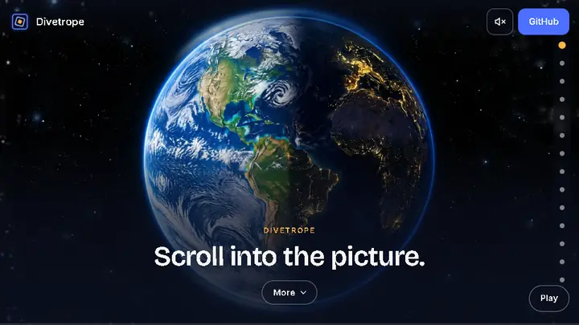

<p align="center"></p>

<h1 align="center">Divetrope</h1>

<p align="center"><b>Scroll into the picture.</b><br>
An open-source web component for endless-zoom stories.</p>

<p align="center"></p>

Each scene hides the next one in its centre, and the last one hides the
first. Readers scroll, drag or press Play to dive through them. Divetrope is
the player for that kind of story: one dependency-free script, a JSON file
for the copy and colours, and a small Python build that turns your layer
images into a static site.

**Live:** [the landing page](https://divetrope.github.io/divetrope/) is a
dive, and the [embed demo](https://divetrope.github.io/divetrope/demo.html)
shows all three ways to put one on a page.

## Quick start

```
pip install -r requirements.txt
python build.py examples/yepedu                    # writes examples/yepedu/site/
python tools/serve.py examples/yepedu/site 8000    # then open http://127.0.0.1:8000/
```

To make your own, start a folder, add your layer images, list them in
`dive.json`, check the seams and build:

```
python build.py new mydive
python build.py check mydive
python build.py mydive
```

The site is plain static files. Host it anywhere: GitHub Pages, Netlify,
Cloudflare Pages, S3, your own server.

## Put it on a page

```html
<script src="https://YOUR-HOST/mydive/divetrope.js" defer></script>

<!-- a window with its own Play button (the default) -->
<divetrope-player src="https://YOUR-HOST/mydive/manifest.json"></divetrope-player>

<!-- a section that pins while the reader scrolls through it -->
<divetrope-player src="https://YOUR-HOST/mydive/manifest.json" mode="scroll"></divetrope-player>
```

For a CMS that strips scripts, use the player page in an iframe:

```html
<iframe src="https://YOUR-HOST/mydive/embed.html?autoplay=1"
        style="width:100%; aspect-ratio:16/9; border:0"
        allow="autoplay; fullscreen" allowfullscreen></iframe>
```

| Attribute | |
|---|---|
| `src` | The dive's `manifest.json`. Layer files are found next to it. |
| `mode` | `player` (default), `scroll`, or `page` for a whole page. |
| `chrome` | `full` shows the brand bar and its button. `minimal` (the default outside page mode) keeps sound and full screen. |
| `autoplay` | Player only: plays muted while at least half of it is in view, until the reader takes over. |

From script: `el.play()`, `el.pause()`, `el.restart()`, `el.goTo(i)`,
`el.seek(t)`, and `el.dive` for the current state. Events: `dt-ready`,
`dt-scene` (`detail.scene`), `dt-play`, `dt-pause`, `dt-end`.

Embedding from another domain needs CORS on the host. The build writes a
`_headers` file that covers Netlify and Cloudflare Pages.

## How it moves

- Play runs the story as one continuous take: it slows as each scene fills
  the screen and never stops and starts.
- While it plays, only the headline and a More button show. Pause eases
  forward to the next scene and opens the full text. Nothing rewinds.
- Scrolling, dragging and the wheel follow a damped spring, so the speed
  never jumps with each wheel notch.
- A score is synthesized live with Web Audio, changing chord with each
  scene. There are no audio files.
- With `prefers-reduced-motion`, the zoom follows the scroll directly with no
  easing, and scene videos stay still.
- Screen readers hear each scene's `alt` text as it arrives, then its
  headline. The dots are labelled buttons, and the keyboard can play, pause
  and step.

## Docs

- [dive.json](docs/dive-json.md): layers, copy, brand, theme, end card, score.
- [Making layers](docs/making-layers.md): the rules that make the seams
  disappear, and a workflow for any image model.

## Testing

The `tools/` scripts drive headless Chrome (`pip install playwright`) against
a built site:

| Script | Checks |
|---|---|
| `smooth_test.py <url> [--mobile]` | A full Play run: no stalls, jumps or reversals |
| `embed_test.py <url> [--mobile]` | The player window, the scroll section and the iframe |
| `gesture_test.py <url>` | Phone gestures: Play moves at once, a tap keeps playing, a swipe pauses |
| `pop_test.py <url>` | No layer pops in at a scene boundary |
| `scrub_test.py <url> page\|player\|section` | Hand scrolling keeps a smooth speed |
| `shoot.py <url> <t>...` | Screenshots at given dive positions |
| `render_score.py <url> <out.wav>` | Renders the score to a WAV file |

## Examples

- `examples/space`: the landing page. A loop from Earth to a city, a
  rooftop, a glass of champagne, a bubble, a galaxy, and back to Earth.
- `examples/yepedu`: a one-minute commercial for
  [Yep Edu](https://edu.yepgent.com/), ending on a call to action. It isn't
  on this project's site, because GitHub Pages is not for commercial pages;
  build it with the quick start above.

The example images were generated with AI image models.

## License

[MIT](LICENSE) for the code. The example images are offered under the same
license to the extent they are protected by copyright, which images made by
AI may not be. Icons and fonts from other projects keep their own licenses:
see [THIRD_PARTY_NOTICES.md](THIRD_PARTY_NOTICES.md). The Divetrope and Yep
Edu names and logos are trademarks and are not covered by any of these
licenses.
